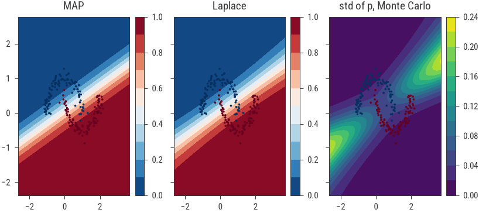
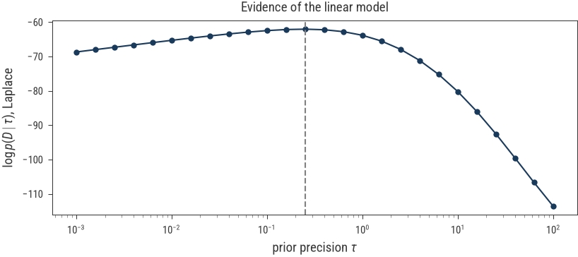
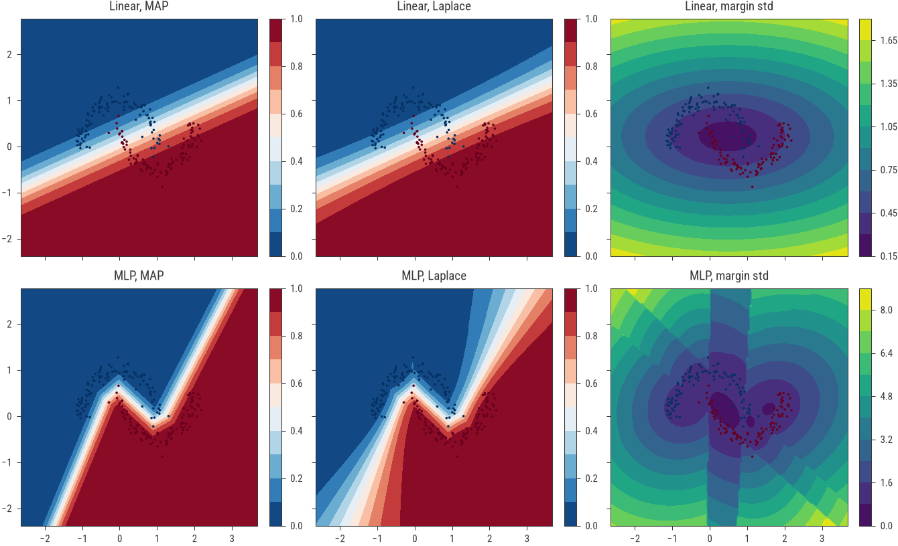
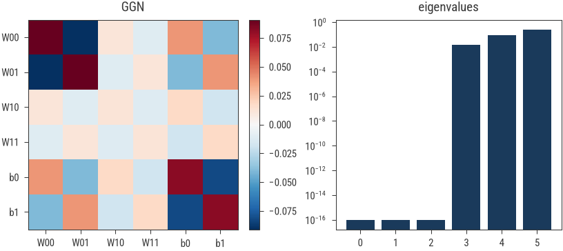
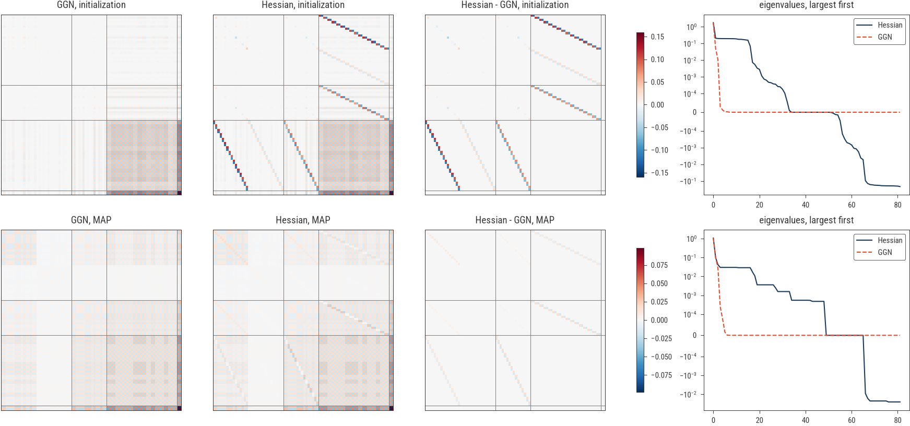

# curvgrad

From-scratch autograd + curvature-based Laplace approximation, applied
to both neural network weight posteriors and GLMM random effects.

## Idea

- Laplace approximation as same method in two fields:
  - Bayesian deep learning: linearized Laplace over NN weights
  - Classical stats: Laplace approx. for GLMM random effects
- Both estimated from one shared curvature core (GGN / Fisher)

## What's in here

- `autograd.py`, `ops.py`, `tensor.py` — autograd engine with reverse (VJP) and forward (JVP) mode, NumPy only
- `nn/` — Linear, MLP (relu or sigmoid), cross entropy and its Hessian-vector product
- `curvature/ggn.py` — matrix-free GGN product `G v = Jᵀ H J v`, dense GGN and Jacobian for small models
- `curvature/laplace.py` — posterior precision, Newton / IRLS step to the MAP, posterior samples,
  linearized predictive (margin moments + probit), log marginal likelihood
- `glmm/` — link functions, random intercepts/slopes, Laplace-based fit (planned)
- PyTorch used only in tests, as a gradient-check oracle — never at runtime

## Results


*Logistic regression on two moons: MAP, linearized Laplace and Monte Carlo std of p.*


*Laplace evidence against the prior precision τ.*


*Linear model against a 2-16-2 relu MLP: MAP, Laplace and margin std.*


*GGN of the linear model and its eigenvalues.*


*GGN against the finite-difference Hessian of a sigmoid MLP, at initialization and at the MAP.*

## Status

- [x] Autograd core (ops, VJP + JVP, finite-difference checks)
- [x] Linear + cross entropy, logistic regression example
- [x] GGN (matrix-free, checked against the exact Hessian)
- [x] Laplace: Newton MAP, posterior precision, sampling, linearized predictive
- [x] Laplace evidence and choice of τ
- [ ] Laplace tests
- [x] MLP + linearized Laplace, MLP vs. linear comparison, GGN vs. Hessian
- [ ] curvgrad vs. torch.nn parity example
- [ ] GLMM: random intercepts
- [ ] GLMM: random slopes
- [ ] Hierarchical Poisson GLMM example

## Quickstart

```bash
uv sync
uv run python examples/classification.py
uv run python examples/mlp_classification.py
```

`classification.py` fits logistic regression on two moons, plots the GGN, finds the MAP with Newton's
method, plots the linearized Laplace predictive and sweeps the evidence over τ.
`mlp_classification.py` compares linear model and MLP under Laplace and the MLP's GGN with its Hessian.
Figures are written to `docs/figures/`.

## Tests

`uv run pytest` — every op's VJP and JVP against finite differences, the GGN against a
finite-difference Hessian and an explicit `Σ Jᵀ H J`. Planned: Laplace tests,
`torch.autograd.gradcheck`, GLMM fits vs. `lme4`.
